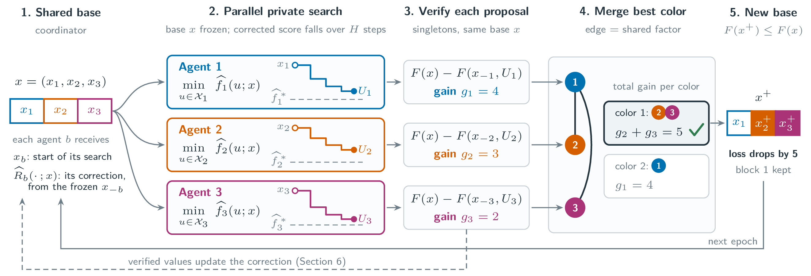

# Local Work, Global Progress: A Convergence Theory of AI Agent Collaboration

[](https://arxiv.org/abs/XXXX.XXXXX)



Code and data for the paper by Ivan Ilin and Peter Richtárik. Several agents improve one shared solution: each
agent owns one part of it, searches that part privately against a local objective plus a **correction** for how its
changes affect the other parts, and a coordinator checks every proposal against the global objective before merging
proposals that do not interfere. The paper proves linear convergence up to an error floor that vanishes with exact
corrections, and shows that merging the best checked combination of proposals keeps this guarantee with a rate set
by how well the proposals actually combine.

This repository contains the three experiments of the paper:

* **Robot routing with LLM agents** (`routing/`, Section 8.1): teams of GPT-OSS-120B agents plan collision-free
  routes for nine robots on two maps and eighteen robots on two floors, against single agents and single agents
  searching in parallel. Includes the agents and prompts, a launcher for new runs, the records of all runs of the
  paper and the audits of the theory's constants.
* **Execution feedback in SQLite** (`sqlite/`, Section 8.2): a join-order controller that learns its correction
  from the engine's own execution counters.
* **A synthetic task with certified constants** (`synthetic/`, Section 8.3): convergence, error floor, private-work
  horizon and correction learning, compared with the theory exactly.

## Citation

```bibtex
@misc{ilin2026localwork,
  title         = {Local Work, Global Progress: A Convergence Theory of AI Agent Collaboration},
  author        = {Ilin, Ivan and Richt{\'a}rik, Peter},
  year          = {2026},
  eprint        = {XXXX.XXXXX},
  archivePrefix = {arXiv},
  primaryClass  = {cs.MA}
}
```

## Install

Python 3.9 or newer; NumPy is the only dependency (the paper used Python 3.9.6 and NumPy 2.0.2). The SQLite study
also needs a C compiler and a Unix shell (macOS or Linux).

```bash
git clone https://github.com/vectozavr/local-work-global-progress.git
cd local-work-global-progress
python -m venv .venv && source .venv/bin/activate
pip install -r requirements.txt
```

## Robot routing with LLM agents

Every campaign of the paper is a file in `routing/campaigns/`. New runs need an [OpenRouter](https://openrouter.ai)
API key in the environment or in a `.env` file (see `.env.example`):

```bash
python routing/run_campaign.py --list
python routing/show_prompt.py map1-team                      # the prompt of agent 1, no model call
python routing/run_campaign.py map1-team --seeds 0-2 --execute
```

A run on one map costs about USD 0.14 to 0.36 and takes 5 to 10 minutes. Prompts, protocol, model and maps are easy
to change; see [`routing/README.md`](routing/README.md).

The results of the paper can be recomputed from the recorded runs, without any model call, in about two minutes:

```bash
python routing/analysis/run_all.py
```

It reads `data/` and writes the statistics, tests and theory bounds reported in the paper as JSON files in
`routing/analysis/`.

## SQLite and the synthetic task

```bash
python synthetic/known-correction/run.py    # then approximate-correction, learned-correction, verification-reuse
sh sqlite/build_sqlite.sh                   # then the four scripts listed in sqlite/README.md
```

The synthetic experiments take about a minute in total, with fixed seeds; the SQLite study needs a C compiler and
about 1 GB of disk, and its times depend on the machine. See [`synthetic/README.md`](synthetic/README.md) and
[`sqlite/README.md`](sqlite/README.md).

## Repository layout

```
routing/
  robot_routing/   the grid world, prompts, team and single-agent protocols, the model client
  maps/            the two maps and the two-floor task, with certified optima
  campaigns/       one file per campaign of the paper
  run_campaign.py  run a campaign
  show_prompt.py   print a campaign's first prompt
  analysis/        statistics and tests of the paper, audit of the theory's constants
sqlite/            the SQLite study (downloads and builds SQLite 3.46.1)
synthetic/         the four synthetic experiments
data/              records of the routing runs of the paper and the measured constants (21 MB)
```

## Data

`data/` holds the records that `routing/analysis/run_all.py` reads: the plans, final results and replayed summaries
of all routing runs of the paper, and the constants of the theory measured on them. The full records, with every
prompt, model answer, returned reasoning and raw API response (3.4 GB, 0.5 GB compressed), are needed only to replay
the runs or to repeat the audit of the constants; they are in a separate data archive: [link](XXXX). The SQLite and
synthetic results are not stored: their scripts regenerate them.

## License

MIT; see [LICENSE](LICENSE). SQLite, downloaded by `sqlite/build_sqlite.sh`, is in the public domain.
